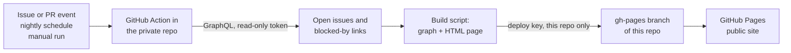

# Hexagonal Front backlog map

**Live map:** https://tekkabroley.github.io/hexagonalfront-backlog/

This repo hosts a single web page: a dependency map of the open issues in Hexagonal Front, a board game being built as a web app. Its source repo is private. The map shows which work is ready to start now and what each blocked issue is waiting on.

> This repo is generated. Every deploy replaces the whole branch, so don't edit files here. This README is published from `scripts/backlog-map/site-readme.md` in the source repo.

## What the map shows

- **Every open issue** in the game's backlog, laid out left to right in dependency order. Issues with nothing blocking them sit in the leftmost column, and each column to the right depends on something earlier.
- **Arrows** for GitHub's native "blocked by" links between issues.
- **Colors** for each issue's state: ready to start, blocked, in progress (an open pull request is linked), or a closed blocker kept for context.
- **An "Unordered" group** for open issues with no dependency links.
- **Search and label filters.** Filters dim non-matching issues instead of rearranging the layout, so the map stays familiar.
- Click an issue to open it on GitHub (only collaborators on the private repo can see it). Hover to see its title, labels and blockers. A timestamp shows when the page was last built.

## How it works

1. **Trigger.** A workflow in the private repo runs when issues are opened, edited, closed, reopened, deleted or relabeled, and when pull requests are opened, edited, reopened or closed. It also runs nightly at 10:00 UTC and on demand. GitHub has no event for changes to blocked-by links, so the nightly run catches those (they can take up to 24 hours to show up).
2. **Fetch.** The workflow reads open issues, labels, blocked-by links and linked pull requests from GitHub's GraphQL API, using the built-in read-only Actions token.
3. **Build.** A small Node script turns that data into a dependency graph and renders a single `index.html`. In your browser, the page loads Cytoscape (a graph-drawing library) and dagre (a layout engine for layered diagrams) from a CDN, with pinned versions and integrity hashes, and draws the map.
4. **Publish.** The page is pushed to this repo's `gh-pages` branch with an SSH deploy key that can write to this repo and nothing else. Each deploy replaces the branch's history, since the page is rebuilt from scratch every time.
5. **Serve.** GitHub Pages serves the branch as a static site.

If two builds overlap, the newer one cancels the older one. Each build is a complete snapshot, so only the latest one matters.

## Why a separate public repo

The game's source repo is private, and GitHub Pages for a private repo needs a paid plan. This repo exists only to hold the rendered page, so no source code, issue bodies, comments or history are published.

The deploy key is only available to the workflow when it runs from `main` in the source repo. A branch or pull request that changes the workflow can't read the key or publish.

## What's published

Each issue's number, title, labels, state and URL, plus the links between issues. Nothing else.
